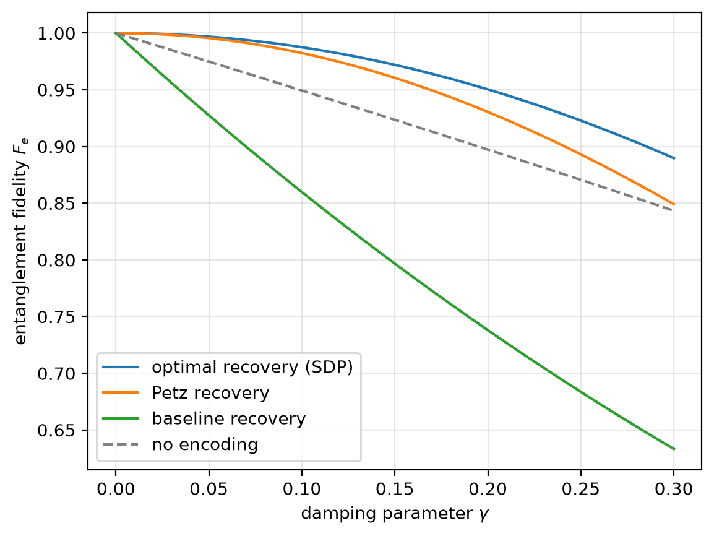
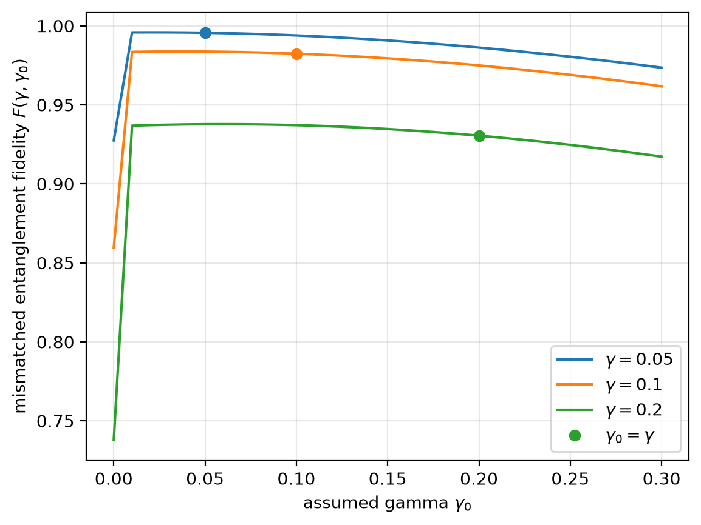
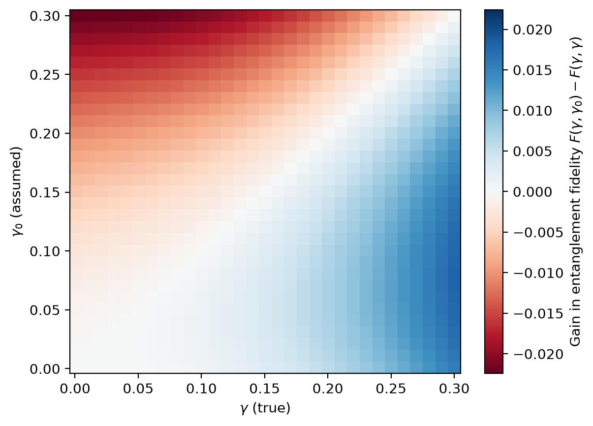
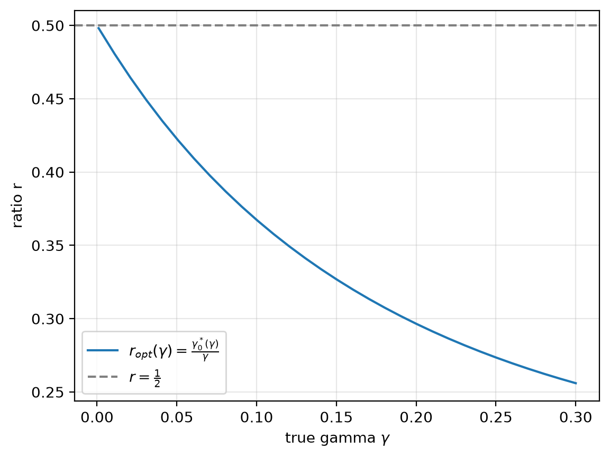

# Petz, SDP-Optimal and Mismatched Petz Recovery for the Four-Qubit Amplitude-Damping Code

A self-directed student research project in approximate quantum error correction. It benchmarks recovery maps for the four-qubit Leung–Nielsen–Chuang–Yamamoto (LNCY) code under amplitude damping, then asks what happens when the Petz decoder is built for the wrong noise strength.

**Mathematical note:** [*Mismatched Petz recovery for the Leung code under weak amplitude damping*](paper/mismatched_petz_note.pdf) (PDF, 8 pages; [LaTeX source](paper/mismatched_petz_note.tex)).

## Overview

A logical qubit is encoded in the LNCY code, and each of the four physical qubits undergoes amplitude damping with parameter $\gamma$. Recovery maps are compared through the entanglement fidelity $F_e$ of the logical qubit. The project was carried out in two stages, both completed.

- **Part I — Recovery benchmarking.** Implements and compares a projection-and-decoding baseline, the Petz (transpose-channel) recovery and the SDP-optimal recovery, and measures how their infidelities scale at weak noise.
- **Part II — Mismatched Petz recovery.** A Petz decoder is built from a noise model. In practice a damping rate is estimated rather than known, so the decoder is built for an *assumed* parameter $h$ while the noise acts with the *true* parameter $\gamma$. Numerically, decoders built for $h<\gamma$ can outperform the matched decoder ($h=\gamma$). A weak-noise expansion, proved in the note, explains this.

## Key results

**Part I (numerical, $0\le\gamma\le0.3$).** Weak-noise behaviour of the infidelity:

| Recovery | $1-F_e$ at small $\gamma$ |
|---|---|
| no encoding (one bare qubit) | $\approx 0.5\,\gamma$ |
| projection-and-decoding baseline | $\approx 1.5\,\gamma$ |
| Petz, built for the true $\gamma$ | $\approx 1.75\,\gamma^2$ |
| SDP-optimal recovery | $\approx 1.25\,\gamma^2$ |

**Part II (analytical).** Let $F(\gamma,h)$ be the entanglement fidelity of the Petz decoder built for $h$ when the true damping parameter is $\gamma$. For every fixed ratio $r>0$, as $\gamma\to0^+$,

```math
F(\gamma,r\gamma)=1-\Big[\frac74+\Big(1-\frac{1}{\sqrt2}\Big)\,r(r-1)\Big]\gamma^2+O(\gamma^3),
```

with a remainder that is uniform for $r$ in compact subsets of $(0,\infty)$. Writing the bracket as $c(r)=\frac32+\frac{1}{4\sqrt2}+\big(1-\frac{1}{\sqrt2}\big)\big(r-\frac12\big)^2$:

- the leading-order infidelity coefficient is minimised at $r^\star=\frac12$, where $c(r^\star)=\frac32+\frac{1}{4\sqrt2}\approx1.677$, compared with $c(1)=\frac74$ for the matched decoder;
- at leading order, every under-estimate $0<r<1$ beats the matched decoder, and every over-estimate $r>1$ does worse;
- the best gain, $\frac{2-\sqrt2}{8}\gamma^2\approx0.073\,\gamma^2$, is modest: about 4% of the matched infidelity and about 15% of its gap to the SDP optimum.

> **Scope.** This is leading-order optimality *within the family of Petz decoders built for $h=r\gamma$ with fixed $r$*. It is not optimality among arbitrary recovery channels, since the SDP optimum is better. Nor does it hold at every finite noise strength: the numerically optimal ratio drifts below $\frac12$ as $\gamma$ grows (0.37 at $\gamma=0.1$, 0.26 at $\gamma=0.3$).

## 1. Mathematical framework

**Code.** The LNCY code [1] encodes one logical qubit into four physical qubits:

```math
|0_L\rangle=\frac{|0000\rangle+|1111\rangle}{\sqrt2},\qquad
|1_L\rangle=\frac{|0011\rangle+|1100\rangle}{\sqrt2}.
```

The encoding isometry $`V=|0_L\rangle\langle0|+|1_L\rangle\langle1|`$ is a $16\times2$ matrix with $V^\dagger V=I_2$, and $\Pi=VV^\dagger$ is the code projector (`src/codes.py`).

**Noise.** Each physical qubit undergoes amplitude damping with Kraus operators

```math
K_0=\begin{pmatrix}1&0\\0&\sqrt{1-\gamma}\end{pmatrix},\qquad
K_1=\begin{pmatrix}0&\sqrt{\gamma}\\0&0\end{pmatrix}.
```

The encoded noisy channel $\Phi_\gamma$ has the 16 Kraus operators $`E_j(\gamma)=(K_{j_1}\otimes\cdots\otimes K_{j_4})\,V`$, one for each bit string $`j\in\lbrace0,1\rbrace^4`$, where $`j_i=1`$ means that qubit $i$ decayed (`src/channels.py`).

**Entanglement fidelity.** For a qubit channel $\mathcal C$ with Kraus operators $\lbrace L_i\rbrace$,

```math
F_e(\mathcal C)=\langle\Phi^+|(\mathrm{id}\otimes\mathcal C)\big(|\Phi^+\rangle\langle\Phi^+|\big)|\Phi^+\rangle=\frac14\sum_i\big|\mathrm{Tr}\,L_i\big|^2,\qquad|\Phi^+\rangle=\frac{|00\rangle+|11\rangle}{\sqrt2},
```

evaluated for $\mathcal C=\mathcal R\circ\Phi_\gamma$ (`src/fidelity.py`). For reference, a bare qubit under amplitude damping has $F_e=(1+\sqrt{1-\gamma})^2/4$.

**Recovery maps.** Each recovery $\mathcal R:\mathcal B(\mathbb C^{16})\to\mathcal B(\mathbb C^2)$ is completely positive and trace preserving (CPTP).

*Projection-and-decoding baseline* (`src/recovery.py`). Keep the state if it is in the code space and decode it; otherwise output the maximally mixed state:

```math
\mathcal R_{\mathrm{base}}(X)=V^\dagger XV+\mathrm{Tr}\big[(I-\Pi)X\big]\,\frac{I_2}{2}.
```

*Petz recovery* [2, 3] (`src/petz.py`). With reference state $\sigma=I_2/2$ and $\tau_h=\Phi_h(\sigma)$, the Petz decoder built for the parameter $h$ is

```math
\mathcal R_h(X)=\sigma^{1/2}\,\Phi_h^\dagger\big(\tau_h^{-1/2}X\,\tau_h^{-1/2}\big)\,\sigma^{1/2},\qquad
R_k(h)=\frac{1}{\sqrt2}\,E_k(h)^\dagger\,\tau_h^{-1/2}.
```

The *matched* decoder uses $h=\gamma$ (Part I). The *mismatched* decoder uses $h\neq\gamma$ (Part II, `src/robustness.py`). For $0<h<1$, $\tau_h$ is invertible and the map is trace preserving. When $\tau_h$ is singular ($h=0$ or $h=1$), the code takes the pseudo-inverse on the support of $\tau_h$ and completes the map on its kernel by outputting $I_2/2$. At $h=0$ this reproduces the baseline exactly.

*SDP-optimal recovery* [4] (`src/sdp.py`). In terms of the Choi matrix $`J_{\mathcal R}=\sum_{a,b}|a\rangle\langle b|\otimes\mathcal R(|a\rangle\langle b|)\in\mathbb C^{32\times32}`$ (input first), the fidelity is linear, $`F_e=\mathrm{Tr}(C_\gamma J_{\mathcal R})`$, and the best recovery solves

```math
\max_{J\succeq0}\ \mathrm{Tr}(C_\gamma J)\quad\text{subject to}\quad\mathrm{Tr}_{\mathrm{out}}J=I_{16},\qquad
C_\gamma=\frac14\sum_{i,j=0}^{1}\Phi_\gamma\big(|i\rangle\langle j|\big)^{T}\otimes\big(|i\rangle\langle j|\big)^{T}.
```

It is solved with CVXPY and SCS. As a consistency check, the Choi matrix of the Petz map reproduces the Petz fidelity computed from its Kraus operators (`tests/test_sdp.py`).

## 2. Part I — Recovery benchmarking

All Part I results use the 31 values $\gamma=0,0.01,\dots,0.3$ and are stored in [`data/fidelities.csv`](data/fidelities.csv) (columns `gamma,baseline,petz,sdp`).

<p align="center">
  
  
</p>

- **The baseline fails at first order.** A single decay sends $|0_L\rangle$ and $|1_L\rangle$ to orthogonal states outside the code space, which depend on which qubit decayed. The information is moved, not destroyed, but the baseline only looks inside the code space and outputs $I_2/2$. Its infidelity of about $1.5\gamma$ is worse than that of a bare qubit for every $\gamma>0$ tested.
- **Petz and the SDP optimum fail only at second order.** Both use the noise model and correct single decays. The remaining $O(\gamma^2)$ error comes from double decays and from a slight distortion of the no-decay branch, which damps $|0_L\rangle$ and $|1_L\rangle$ differently. The LNCY code satisfies the Knill–Laflamme conditions only to first order in $\gamma$: it is an *approximate* code [1].
- **Petz is near-optimal.** The gap $`F_e^{\mathrm{SDP}}-F_e^{\mathrm{Petz}}\approx0.5\,\gamma^2`$ is $5\times10^{-5}$ at $\gamma=0.01$, $0.005$ at $\gamma=0.1$ and $0.041$ at $\gamma=0.3$, and the ratio of infidelities stays between 1.37 and 1.41. This is consistent with the general near-optimality guarantee for the Petz map [2].

A Petz-versus-baseline plot is in [`figures/petz_vs_baseline.png`](figures/petz_vs_baseline.png). For the LNCY code, these comparisons reproduce part of the numerical study of Burri [5], which also covers the twirled Petz and Schumacher–Westmoreland decoders (not implemented here).

## 3. Part II — Mismatched Petz recovery

### 3.1 Numerical observation

`mismatched_petz_fidelity(gamma_true, gamma_assumed)` in `src/robustness.py` evaluates $F(\gamma,h)$, and `optimal_petz_calibration(gamma_true)` in `src/calibration.py` maximises it over $h$. In the code and figures the assumed parameter $h$ is written $\gamma_0$.

<p align="center">
  
</p>

For $\gamma=0.05$, $0.1$ and $0.2$, the fidelity peaks at an assumed parameter *below* the true one (the dots mark $h=\gamma$), and it drops to the baseline value at $h=0$.

<p align="center">
  
  
</p>

*Left:* the gain $F(\gamma,h)-F(\gamma,\gamma)$ over the matched decoder, on a $31\times31$ grid with $0.001\le\gamma,h\le0.3$. It is positive (blue) below the diagonal $h=\gamma$ and negative above it. *Right:* the optimal ratio $h^\star(\gamma)/\gamma$. It approaches $\frac12$ at weak noise (0.48 at $\gamma=0.01$) and falls to 0.37 at $\gamma=0.1$ and 0.26 at $\gamma=0.3$. At $\gamma=0.3$ the best calibration raises $F$ from 0.849 to 0.867. A heat map of $F$ itself, with the optimal curve, is in [`figures/optimal_calibration_heatmap.png`](figures/optimal_calibration_heatmap.png).

### 3.2 Analytical result

The expansion stated in [Key results](#key-results) is Theorem 1 of the [note](paper/mismatched_petz_note.pdf). In its notation, $`F(\gamma,h)=\frac18\sum_{k,j}T_{kj}^2`$ with $`T_{kj}=\mathrm{Tr}\big(E_k(h)^\dagger\,\tau_h^{-1/2}\,E_j(\gamma)\big)`$, a sum over 256 traces. The proof is a direct computation organised around a few structural facts:

1. Every Kraus column $E_j(\gamma)|\ell\rangle$ is a multiple of a single computational basis vector, except the two columns of the no-decay operator.
2. $\tau_h$ is block diagonal, with two $2\times2$ blocks on $\mathrm{span}\lbrace|0000\rangle,|1111\rangle\rbrace$ and $\mathrm{span}\lbrace|0011\rangle,|1100\rangle\rbrace$ and twelve one-dimensional blocks, so $\tau_h^{-1/2}$ is explicit.
3. Hence only 20 of the 256 traces are non-zero, and each has a closed form.
4. **The first-order terms cancel.** For a single decay, the $O(\sqrt h)$ coefficients of $E_k(h)$ are exactly compensated by $O(1/\sqrt h)$ entries of $\tau_h^{-1/2}$. Single decays are therefore corrected at leading order for *every* $h>0$, and the four single-decay traces contribute $+16\gamma$ to $8F$, cancelling the $-16\gamma$ of the no-decay trace.
5. **Where $c(r)$ comes from.** At order $\gamma^2$, the $r$-dependence comes only from the no-decay trace. It combines a cross term $(\sqrt2-1)\,r$, between the true damping and the first-order dependence of the decoder on $h$, and a pure $h^2$ term $-(\sqrt2-1)\,r^2$. Their sum is proportional to $r(1-r)$, which is largest at $r=\frac12$.

**Numerical convergence.** The table compares $(1-F(\gamma,r\gamma))/\gamma^2$, computed with `mismatched_petz_fidelity`, with $c(r)$ (Table 3 of the note).

| $r$ | $\gamma=10^{-1}$ | $\gamma=10^{-2}$ | $\gamma=10^{-3}$ | $c(r)$ |
|---|---|---|---|---|
| 1/4 | 1.6298 | 1.6889 | 1.6945 | 1.6951 |
| 1/2 | 1.6311 | 1.6728 | 1.6764 | 1.6768 |
| 1 | 1.7624 | 1.7528 | 1.7503 | 1.7500 |
| 2 | 2.5087 | 2.3580 | 2.3380 | 2.3358 |

The difference shrinks roughly linearly in $\gamma$, as expected from the $O(\gamma^3)$ remainder. `notebooks/petz_calibration.ipynb` makes the same comparison for $0.1\le r\le2$ and $\gamma$ down to $10^{-3}$. Below $\gamma\approx10^{-4}$ the floating-point computation loses accuracy, because $\tau_h$ has eigenvalues of order $h^2$.

**The singular case $h=0$.** At $h=0$, $\tau_0=\Pi/2$ has rank two, and the completed decoder is the baseline, with $1-F(\gamma,0)=\frac32\gamma+O(\gamma^2)$. For every fixed $r>0$ the infidelity is $O(\gamma^2)$, and $c(r)\to\frac74$ as $r\to0^+$, so the limits $r\to0^+$ and $\gamma\to0^+$ do not commute. The $O(\gamma^2)$ behaviour requires $h$ to scale with $\gamma$. For a fixed $h>0$ that does not shrink with $\gamma$, the decoder also distorts the noiseless code space, and $F(\gamma,h)$ tends to a value below 1 as $\gamma\to0$; numerically, $F(\gamma,0.05)\to0.99928$.

**Comparison with SDP-optimal recovery.** The SDP optimum gives $`(1-F_{\mathrm{opt}})/\gamma^2\approx1.250`$ for $\gamma\le0.05$, a numerical observation rather than part of the theorem. At weak noise the best fixed-ratio Petz decoder ($c=1.677$) therefore closes only $(c(1)-c(\frac12))/(c(1)-1.25)\approx15\%$ of the gap between the matched Petz decoder and the optimum. At $\gamma=0.3$ the numerically optimised calibration closes 44% of it ($F=0.867$, against 0.849 matched and 0.890 optimal). Tuning a single noise parameter does not reach the optimum.

**How to read the result.** If $\gamma$ is known or well estimated, building the Petz decoder for about half of it slightly improves the weak-noise fidelity. This does not show that under-estimating an unknown noise level is optimal in general. The analysis assumes a fixed ratio $h/\gamma$, is asymptotic in $\gamma$ and does not model estimation uncertainty. The decoder should never be built for $h=0$.

## 4. Repository structure

```text
qec-optimal-recovery/
├── README.md
├── pyproject.toml          # package metadata and pytest configuration
├── requirements.txt
├── src/
│   ├── codes.py            # basis states, Leung isometry V, code projector
│   ├── channels.py         # amplitude damping, 4-qubit Kraus operators, noisy encoding
│   ├── fidelity.py         # entanglement fidelity from Kraus operators
│   ├── recovery.py         # projection-and-decoding baseline
│   ├── petz.py             # Petz recovery (pseudo-inverse, completion)
│   ├── sdp.py              # objective matrix C and SDP-optimal recovery
│   ├── robustness.py       # fidelity of the Petz decoder built for an assumed parameter
│   └── calibration.py      # optimisation of the assumed parameter
├── tests/                  # pytest suite: 193 tests in 7 files
├── notebooks/
│   ├── petz_vs_baseline.ipynb   # Part I: Petz vs. baseline, with discussion
│   ├── optimal_decoder.ipynb    # Part I: Petz vs. SDP optimum, optimality gap
│   ├── robustness.ipynb         # Part II: fidelity vs. assumed parameter
│   └── petz_calibration.ipynb   # Part II: optimal calibration, heat maps, check of c(r)
├── paper/
│   ├── mismatched_petz_note.tex
│   └── mismatched_petz_note.pdf
├── data/
│   └── fidelities.csv      # Part I fidelities
└── figures/                # all figures, regenerated by the notebooks
```

## 5. Installation and reproducibility

### Installation

From the repository root, with Python ≥ 3.10:

```bash
python3 -m venv .venv
source .venv/bin/activate
pip install -r requirements.txt
pip install -e .
```

`pip install -e .` makes the modules in `src/` importable from the notebooks. `requirements.txt` does not pin versions. The results above were produced with Python 3.12.7, NumPy 2.5.4, SciPy 1.18.1, CVXPY 1.9.3, SCS 3.3.1, Matplotlib 3.11.2 and pytest 9.1.1.

### Tests

```bash
python -m pytest -q
```

The 193 tests run in a few seconds. Among other things, they check that $V$ is an isometry, that the noise channel preserves trace and positivity, known values of the entanglement fidelity, and that the baseline and completed Petz maps are trace preserving. They also check that the Petz map recovers its reference state, and that the SDP solution is a valid CPTP map whose fidelity is at least the Petz and baseline ones. For Part II, they check that `mismatched_petz_fidelity` agrees with the direct Petz computation when $h=\gamma$, and that no mismatched decoder exceeds the SDP optimum on a $7\times7$ grid of $(\gamma,h)$. `calibration.py` has no dedicated test.

### Notebooks and figures

```bash
jupyter nbconvert --to notebook --execute --inplace notebooks/petz_vs_baseline.ipynb notebooks/optimal_decoder.ipynb notebooks/robustness.ipynb notebooks/petz_calibration.ipynb
```

This reruns the four notebooks (about 30 s in total) and rewrites the seven figures in `figures/` and `data/fidelities.csv`. With the versions above, the regenerated `data/fidelities.csv` is identical to the committed one. The longer discussion of the Part I results is at the end of the Part I notebooks.

The note can be rebuilt from `paper/mismatched_petz_note.tex` with a standard LaTeX distribution, or with [Tectonic](https://tectonic-typesetting.github.io/): `cd paper && tectonic mismatched_petz_note.tex`.

<details>
<summary><b>Solver and numerical tolerances</b></summary>

| Where | Setting | Why |
|---|---|---|
| SDP solver | **SCS** 3.3.1 through CVXPY 1.9.3, `eps=1e-6` (passed as `eps_abs = eps_rel = 1e-6`), `max_iters=30000` | first-order solver, installed with CVXPY |
| SDP accuracy | agrees with the interior-point solver Clarabel to within $6\times10^{-7}$ at $\gamma=0,0.001,0.1,0.32,0.67,1$ | independent check of the optimum |
| Petz pseudo-inverse and support of $\tau$ | eigenvalues $\le10^{-12}$ are treated as zero (absolute cutoff) | rounding noise is never inverted; the smallest true eigenvalue in the Petz tests is $\approx1.8\times10^{-8}$ |
| Mismatched Petz | same cutoff; the smallest eigenvalues of $\tau_h$ are $\approx h^2/4$ | they drop below the cutoff for $h\lesssim2\times10^{-6}$, and $(1-F)/\gamma^2$ loses accuracy below $\gamma\approx10^{-4}$ |
| Calibration | `scipy.optimize.minimize_scalar(method="bounded")` over $10^{-3}\gamma\le h\le1-10^{-4}$, `xatol=1e-7` | the lower bound scales with $\gamma$ so the search works at weak noise |
| Baseline complement basis | `scipy.linalg.orth` with its default cutoff, applied to $I-\Pi$ | $I-\Pi$ is an exact projector |
| Tests: exact identities | `atol=1e-12` | e.g. $V^\dagger V=I$, trace preservation of the baseline, matched case of `mismatched_petz_fidelity` |
| Tests: Petz trace preservation on the support | `atol=1e-8` | $\tau$ is badly conditioned at small $\gamma$ |
| Tests: SDP solution | `1e-4` for positivity and the trace condition, `1e-5` for Hermiticity and $F_e(\gamma=0)=1$, slack `1e-6` when comparing with Petz, baseline and mismatched Petz | limited by the solver accuracy |

**Limitation.** The SCS accuracy ($\sim5\times10^{-7}$) is of the same order as the SDP–Petz gap for $\gamma\lesssim10^{-3}$. For very weak noise, a higher-accuracy solver such as Clarabel (`problem.solve(solver=cp.CLARABEL)`) should be used.

</details>

## 6. Related work and attribution

**Established methods.** The LNCY code [1], the Petz or transpose-channel recovery [2, 3] and SDP-optimal recovery [4] are established constructions. Part I reimplements them and reproduces known numerical behaviour, in particular part of the comparison made by Burri [5] for this code.

**Prior work on noise-adapted and mismatched recovery.** Recovering quantum information with imperfect knowledge of the noise is an established question. Danageozian [6] derives fundamental bounds for recovery maps built from a real-time estimate of a drifting noise parameter, illustrated with the four-qubit amplitude-damping code. Biswas, Vaidya and Mandayam [7] construct quantum circuits for the Petz recovery, with the four-qubit amplitude-damping code as a worked example. Burri [5] analyses the entanglement fidelity of the Petz decoder for one-shot entanglement transmission and compares it numerically with other decoders, including SDP-optimal recovery for the LNCY code.

**This project.** The Part II numerics and the weak-noise calibration theorem are results of this project. They have not been published or peer reviewed. This is a self-directed student research project: the author chose the research direction, wrote the code, notebooks and tests, ran the numerical experiments and outlined the proof strategy.

**AI assistance.** Claude (Anthropic) assisted with the extensive symbolic derivations behind the closed-form traces and the second-order expansion, with preparing the proof, and with drafting the note and this README. During the derivation Claude also ran symbolic (SymPy) cross-checks of the closed forms; these scripts are not part of the repository. Separately, the author carried out parts of the derivation by hand and checked the analytical predictions numerically against the independent implementation in `src/` (see `notebooks/petz_calibration.ipynb`).

## References

1. D. W. Leung, M. A. Nielsen, I. L. Chuang and Y. Yamamoto, *Approximate quantum error correction can lead to better codes*, Phys. Rev. A **56**, 2567 (1997). [DOI](https://doi.org/10.1103/PhysRevA.56.2567)
2. H. Barnum and E. Knill, *Reversing quantum dynamics with near-optimal quantum and classical fidelity*, J. Math. Phys. **43**, 2097 (2002). [DOI](https://doi.org/10.1063/1.1459754)
3. H. K. Ng and P. Mandayam, *Simple approach to approximate quantum error correction based on the transpose channel*, Phys. Rev. A **81**, 062342 (2010). [DOI](https://doi.org/10.1103/PhysRevA.81.062342)
4. A. S. Fletcher, P. W. Shor and M. Z. Win, *Optimum quantum error recovery using semidefinite programming*, Phys. Rev. A **75**, 012338 (2007). [DOI](https://doi.org/10.1103/PhysRevA.75.012338)
5. L. Burri, *Entanglement fidelity of the Petz decoder for one-shot entanglement transmission*, J. Math. Phys. **67**, 102203 (2026). [arXiv:2502.17411](https://arxiv.org/abs/2502.17411)
6. A. Danageozian, *Recovery with incomplete knowledge: fundamental bounds on real-time quantum memories*, Quantum **7**, 1195 (2023). [DOI](https://doi.org/10.22331/q-2023-12-04-1195)
7. D. Biswas, G. M. Vaidya and P. Mandayam, *Noise-adapted recovery circuits for quantum error correction*, Phys. Rev. Research **6**, 043034 (2024). [DOI](https://doi.org/10.1103/PhysRevResearch.6.043034)
8. J. M. Renes, *Quantum Error Correction*, lecture notes, ETH Zürich. [Lecture notes](https://people.phys.ethz.ch/~renes/docs/QEC_20240521.pdf)
