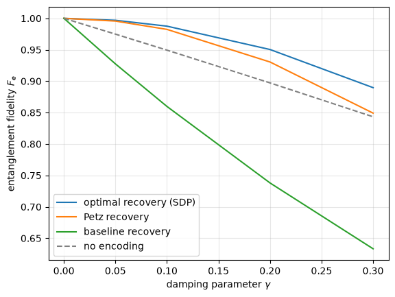
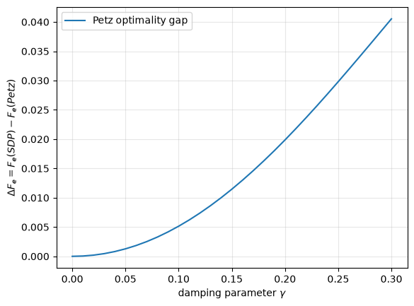

# Quantum Error Correction: Petz vs. SDP-Optimal Recovery

A numerical study of approximate quantum error correction under amplitude-damping noise.

## 1. Overview

This project studies how well a logical qubit can be recovered after it is encoded in the four-qubit Leung–Nielsen–Chuang–Yamamoto (LNCY) code and every physical qubit undergoes amplitude damping with parameter $\gamma$.

Three recovery maps are implemented and compared through their entanglement fidelity:

1. a **projection-and-decoding baseline**, which keeps the state only if it is still in the code space;
2. the **Petz (transpose) recovery map**, built from the noise model;
3. the **optimal recovery**, found by solving a semidefinite program (SDP).

**Main results** (for $0 \le \gamma \le 0.3$):

- The baseline loses fidelity at first order, $1 - F_e \approx 1.5\,\gamma$, and is worse than not encoding at all.
- Petz and the SDP optimum both lose fidelity only at second order: $1 - F_e \approx 1.75\,\gamma^2$ for Petz and $\approx 1.25\,\gamma^2$ for the SDP.
- Petz is near-optimal: its infidelity is about 1.4 times the optimal one at every $\gamma$ tested, and the fidelity gap stays below 0.041.

**Status.** The encoding, the noise channels, the three recovery maps and their comparison are implemented and tested. The next step is to study what happens when the noise assumed by the recovery map differs from the actual noise.

**Attribution.** This is an independent educational project reproducing established results. The LNCY code, the Petz recovery map and SDP-based optimal recovery are existing constructions (see [References](#6-references)); the project does not claim originality for these methods. It aims in particular to reproduce numerical comparisons from the recent work of L. Burri (2026).

## 2. Mathematical Framework

### Four-qubit Leung code

The code encodes one logical qubit into four physical qubits with the codewords

$$
|0_L\rangle = \frac{|0000\rangle+|1111\rangle}{\sqrt{2}},
\qquad
|1_L\rangle = \frac{|0011\rangle+|1100\rangle}{\sqrt{2}}.
$$

The encoding is the isometry $V = |0_L\rangle\langle 0| + |1_L\rangle\langle 1|$, a $16 \times 2$ matrix whose columns are the codewords, with

$$
V^\dagger V = I_2, \qquad P = VV^\dagger \ \text{(code projector)}, \qquad \mathcal E(\rho) = V\rho V^\dagger .
$$

Implemented in `src/codes.py` (`basis_states`, `leung_isometry`, `code_projector`).

### Amplitude-damping channel

Each physical qubit independently undergoes amplitude damping with Kraus operators

$$
A_0=
\begin{pmatrix}
1&0\\
0&\sqrt{1-\gamma}
\end{pmatrix},
\qquad
A_1=
\begin{pmatrix}
0&\sqrt{\gamma}\\
0&0
\end{pmatrix}.
$$

On four qubits the channel $\mathcal N_\gamma^{\otimes 4}$ has 16 Kraus operators $A_{b_1}\otimes A_{b_2}\otimes A_{b_3}\otimes A_{b_4}$, one for each bit string $b \in \{0,1\}^4$ ($b_j = 1$ means qubit $j$ decayed). The noisy encoding channel is

$$
\Phi_\gamma=\mathcal N_\gamma^{\otimes 4}\circ\mathcal E,
\qquad
E_b = \big(A_{b_1}\otimes\cdots\otimes A_{b_4}\big)\,V \quad (16\times 2).
$$

The channel is trace-preserving ($\sum_b E_b^\dagger E_b = I_2$) but not unital. Implemented in `src/channels.py`.

### Entanglement fidelity

Performance is measured with the entanglement fidelity of the full chain $\mathcal R\circ\Phi_\gamma$:

$$
F_e(\mathcal R\circ\Phi_\gamma)=
\langle\Phi^+|
(I\otimes\mathcal R\circ\Phi_\gamma)
(|\Phi^+\rangle\langle\Phi^+|)
|\Phi^+\rangle,
\qquad |\Phi^+\rangle=\frac{|00\rangle+|11\rangle}{\sqrt2}.
$$

For a channel with Kraus operators $\{K_i\}$ on a $d$-dimensional input this reduces to

$$
F_e = \frac{1}{d^2}\sum_i \big|\mathrm{Tr}\,K_i\big|^2 ,
$$

which is what `src/fidelity.py` computes ($d = 2$). As a reference, a single unencoded qubit under amplitude damping has $F_e = (1+\sqrt{1-\gamma})^2/4$.

## 3. Recovery Methods

All three maps take the 16-dimensional noisy state back to one qubit, $\mathcal R : \mathcal B(\mathbb C^{16}) \to \mathcal B(\mathbb C^2)$, and are completely positive and trace-preserving (CPTP).

### Projection-and-decoding baseline

Keep the state if it is in the code space and decode it; otherwise output the maximally mixed state:

$$
\mathcal R_{\text{base}}(X) = V^\dagger X V + \mathrm{Tr}\big[(I-P)X\big]\,\frac{I}{2}.
$$

Its Kraus operators are $V^\dagger$ and $|i\rangle\langle q_k|/\sqrt2$, where $i \in \{0,1\}$ and $\{q_k\}$ is an orthonormal basis of the 14-dimensional complement of the code space: 29 operators in total. Implemented in `src/recovery.py`.

### Petz recovery

With the reference state $\sigma = I/2$ and $\tau = \Phi_\gamma(\sigma)$, the Petz map is

$$
\mathcal R_{\text{Petz}}(X) = \sigma^{1/2}\,\Phi_\gamma^\dagger\!\big(\tau^{-1/2} X \tau^{-1/2}\big)\,\sigma^{1/2},
\qquad
R_b = \sigma^{1/2} E_b^\dagger\, \tau^{-1/2}.
$$

$\tau$ is not full rank, so $\tau^{-1/2}$ is a pseudo-inverse (taken on the support of $\tau$). The map above is then only trace-preserving on $\mathrm{supp}(\tau)$, so it is completed on the kernel of $\tau$ by outputting $I/2$, exactly as in the baseline. Implemented in `src/petz.py` (`petz_kraus`, `completed_petz_kraus`).

### SDP-optimal recovery

A recovery map is described by its Choi matrix (input system first)

$$
J = \sum_{a,b=0}^{15} |a\rangle\langle b| \otimes \mathcal R\big(|a\rangle\langle b|\big) \in \mathbb C^{32\times 32}.
$$

The entanglement fidelity is linear in $J$:

$$
F_e(\mathcal R\circ\Phi_\gamma) = \mathrm{Tr}(CJ),
\qquad
C = \frac14\sum_{i,j=0}^{1} \Phi_\gamma\big(|i\rangle\langle j|\big)^{T} \otimes \big(|i\rangle\langle j|\big)^{T},
$$

so the best recovery is the solution of the SDP

$$
\boxed{
\max_{J}\ \mathrm{Tr}(CJ)
\quad\text{subject to}\quad
J \succeq 0,
\qquad
\mathrm{Tr}_{\text{out}}\, J = I_{16}
}
$$

where $J \succeq 0$ means $\mathcal R$ is completely positive and $\mathrm{Tr}_{\text{out}} J = I_{16}$ means it is trace-preserving. Implemented with CVXPY in `src/sdp.py` (`objective_matrix`, `optimal_recovery`). As a check, building the Choi matrix of the Petz map and evaluating $\mathrm{Tr}(CJ)$ reproduces the Petz fidelity computed from Kraus operators (`tests/test_sdp.py`).

## 4. Numerical Results

All results use 31 values $\gamma = 0, 0.01, \dots, 0.3$. The values are stored in [`data/fidelities.csv`](data/fidelities.csv) (columns `gamma,baseline,petz,sdp`).

### Recovery comparison figure



| $\gamma$ | no encoding | baseline | Petz | SDP optimum |
|---|---|---|---|---|
| 0.05 | 0.9748 | 0.9275 | 0.9956 | 0.9969 |
| 0.10 | 0.9493 | 0.8598 | 0.9824 | 0.9875 |
| 0.20 | 0.8972 | 0.7380 | 0.9305 | 0.9503 |
| 0.30 | 0.8433 | 0.6332 | 0.8491 | 0.8897 |

For small $\gamma$ the infidelities follow:

| recovery | $1 - F_e$ for small $\gamma$ |
|---|---|
| no encoding | $\approx 0.5\,\gamma$ |
| baseline | $\approx 1.5\,\gamma$ |
| Petz | $\approx 1.75\,\gamma^2$ |
| SDP optimum | $\approx 1.25\,\gamma^2$ |

A Petz-vs-baseline only version of this plot is in [`figures/petz_vs_baseline.png`](figures/petz_vs_baseline.png).

### Petz optimality gap



The gap $\Delta F_e = F_e(\text{SDP}) - F_e(\text{Petz})$ grows like $\approx 0.5\,\gamma^2$: $5\times10^{-5}$ at $\gamma = 0.01$, $0.005$ at $\gamma = 0.1$ and $0.041$ at $\gamma = 0.3$. The ratio of infidelities $(1-F_{\text{Petz}})/(1-F_{\text{SDP}})$ stays between 1.37 and 1.41 over the whole range.

### Discussion

- **Why the baseline fails at first order.** A single decay sends $|0_L\rangle$ and $|1_L\rangle$ to two orthogonal states outside the code space, which depend on which qubit decayed. The logical information is moved, not destroyed, but the baseline only looks inside the code space and outputs $I/2$. Encoding into 4 qubits then only adds noise, which is why the baseline is worse than no encoding.
- **Why Petz and the SDP fail only at second order.** Both use the noise model and correct single decays. What remains is of order $\gamma^2$: two decays, and a small distortion of the no-decay branch $A_0^{\otimes 4}V$, which damps $|0_L\rangle$ and $|1_L\rangle$ slightly differently. The Leung code satisfies the Knill–Laflamme conditions only to first order in $\gamma$, i.e. it is an *approximate* error-correcting code, so no recovery can remove the $\gamma^2$ term.
- **Petz is near-optimal.** The SDP improves the $\gamma^2$ coefficient from 1.75 to 1.25 but does not change the scaling. This matches the Barnum–Knill bound $F_e(\text{Petz}) \ge F_e(\text{opt})^2$, i.e. roughly $1 - F_{\text{Petz}} \le 2\,(1 - F_{\text{opt}})$, which holds at every $\gamma$ computed here.

Longer answers to the discussion questions are at the end of each notebook.

## 5. Installation and Reproduction

### Repository layout

```text
qec-optimal-recovery/
├── README.md
├── requirements.txt
├── pyproject.toml
├── src/
│   ├── codes.py        # basis states, Leung isometry V, code projector
│   ├── channels.py     # amplitude damping, 4-qubit Kraus operators, noisy encoding
│   ├── fidelity.py     # entanglement fidelity from Kraus operators
│   ├── recovery.py     # projection-and-decoding baseline
│   ├── petz.py         # Petz recovery (pseudo-inverse, completion)
│   └── sdp.py          # objective matrix C and SDP-optimal recovery
├── tests/              # pytest tests for every module
├── notebooks/
│   ├── petz_vs_baseline.ipynb   # Petz vs. baseline comparison + discussion
│   └── optimal_decoder.ipynb    # Petz vs. SDP optimum, optimality gap + discussion
├── data/
│   └── fidelities.csv
└── figures/
```

### Installation

From the repository root, with Python ≥ 3.10:

```bash
python3 -m venv .venv
source .venv/bin/activate
pip install -r requirements.txt
pip install -e .
```

`pip install -e .` makes the modules in `src/` importable from the notebooks.

Versions used for the results above: Python 3.12.7, NumPy 2.5.4, SciPy 1.18.1, CVXPY 1.9.3, SCS 3.3.1, Matplotlib 3.11.2, pytest 9.1.1.

### Running the tests

```bash
python -m pytest -v
```

The 137 tests check, among other things, that $V$ is an isometry, that the noise channel preserves trace and positivity, known values of the entanglement fidelity, that the baseline and completed Petz maps are trace-preserving, that the Petz map recovers its reference state, and that the SDP solution is a valid CPTP map whose fidelity is at least the Petz and baseline ones.

### Reproducing the plots

```bash
jupyter nbconvert --to notebook --execute --inplace notebooks/petz_vs_baseline.ipynb notebooks/optimal_decoder.ipynb
```

This reruns both notebooks (about 10 s in total) and regenerates every plot inside them. The images in `figures/` were exported from these plots: `petz_vs_baseline.png` from `petz_vs_baseline.ipynb`, and `optimal_sdp_fidelity.png` and `petz_optimality_gap.png` from `optimal_decoder.ipynb`. `data/fidelities.csv` holds the values plotted in `optimal_decoder.ipynb`.

### Solver and numerical tolerances

| Where | Setting | Why |
|---|---|---|
| SDP solver | **SCS** 3.3.1 through CVXPY 1.9.3, `eps=1e-6` (passed to SCS as `eps_abs = eps_rel = 1e-6`), `max_iters=30000` | first-order solver; installed with CVXPY |
| SDP accuracy | agrees with the interior-point solver Clarabel to within $6\times10^{-7}$ at $\gamma = 0, 0.001, 0.1, 0.32, 0.67, 1$ | independent check of the optimum |
| Petz pseudo-inverse and support of $\tau$ | eigenvalues $\le 10^{-12}$ are treated as zero (absolute cutoff) | rounding noise is never inverted; the smallest true eigenvalue in the tests is $\approx 1.8\times10^{-8}$, far above the cutoff |
| Baseline complement basis | `scipy.linalg.orth` with its default cutoff, applied to $I - P$ | $I - P$ is an exact projector (eigenvalues 0 and 1) |
| Tests: exact identities | `atol=1e-12` | e.g. $V^\dagger V = I$, trace preservation of the baseline |
| Tests: Petz trace preservation on the support | `atol=1e-8` | $\tau$ is badly conditioned at small $\gamma$ |
| Tests: SDP solution | `1e-4` for positivity and $\mathrm{Tr}_{\text{out}} J = I$, `1e-5` for Hermiticity and $F_e(\gamma=0) = 1$, slack `1e-6` when comparing with Petz and baseline | limited by the solver accuracy |

**Limitation.** The SCS accuracy ($\sim 5\times10^{-7}$) is of the same order as the SDP–Petz gap for $\gamma \lesssim 10^{-3}$. For very weak noise, a higher-accuracy solver such as Clarabel (`problem.solve(solver=cp.CLARABEL)`) should be used.

## 6. References

1. D. W. Leung, M. A. Nielsen, I. L. Chuang, and Y. Yamamoto, *Approximate quantum error correction can lead to better codes*, Physical Review A 56, 2567 (1997). [DOI](https://doi.org/10.1103/PhysRevA.56.2567)
2. H. Barnum and E. Knill, *Reversing quantum dynamics with near-optimal quantum and classical fidelity*, Journal of Mathematical Physics 43, 2097 (2002). [DOI](https://doi.org/10.1063/1.1459754)
3. A. S. Fletcher, P. W. Shor, and M. Z. Win, *Optimum quantum error recovery using semidefinite programming*, Physical Review A 75, 012338 (2007). [DOI](https://doi.org/10.1103/PhysRevA.75.012338)
4. L. Burri, *Entanglement fidelity of the Petz decoder for one-shot entanglement transmission*, Journal of Mathematical Physics 67, 102203 (2026). [arXiv](https://arxiv.org/abs/2502.17411)
5. J. M. Renes, *Quantum Error Correction*, lecture notes, ETH Zürich. [Lecture notes](https://people.phys.ethz.ch/~renes/docs/QEC_20240521.pdf)
